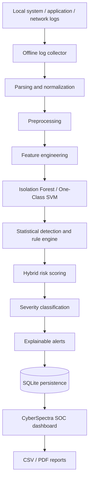

# CYBERSPECTRA — Offline Security Intelligence

An offline, machine-learning-based security monitoring platform. It ingests local logs, detects anomalies, fuses several signals into an explainable risk score, raises severity-based alerts and presents everything in a Streamlit SOC dashboard, with no cloud service or network access required.

> **Status:** working project. Results shown by the app always come from data you analyze locally; this repository contains no performance or accuracy claims beyond the measured benchmark table below.

## Why this exists

Air-gapped and restricted networks cannot send logs to a cloud SIEM, yet still need anomaly detection and alerting. CyberSpectra runs the whole chain (parse → detect → score → alert → report) on one machine, offline.

## Features

- **Offline by design:** local processing only; fonts, charts and CSS are bundled; telemetry is disabled.
- **Multiple log sources:** upload CSV / TXT / LOG / JSON / JSONL (Linux auth & syslog, Windows events, Apache/Nginx, AWS CloudTrail-style), or collect this computer's own logs: Windows Event Log (`wevtutil`), Linux systemd journal and `/var/log/*`, macOS unified log and `/var/log/*`.
- **Hybrid detection:** Isolation Forest or One-Class SVM, plus a statistical detector and a configurable rule engine (safe AST evaluation, no `eval`).
- **Hybrid risk scoring:** a 0–100 score fused from ML, statistical, rule and context signals (weights in `config/defaults.json`), mapped to Low / Medium / High / Critical.
- **Explainable alerts:** every alert stores the contributing signals and rule evidence.
- **SOC dashboard:** Overview, Monitoring, Detection, Alerts (with investigation lifecycle), History, Reports, System; light and dark themes; responsive layout.
- **Critical-alert notifications:** banner, toast and bell badge shown once per alert; acknowledgement is stored separately from the alert.
- **Continuous watch:** folder/file watcher that feeds new lines through the same pipeline.
- **Reports:** CSV and PDF export.

## Architecture



Details: [docs/architecture.md](docs/architecture.md).

## Technology stack

Python · Streamlit · pandas / NumPy · scikit-learn · Plotly · SQLite · ReportLab · watchdog

## Risk scoring and severity

Fusion weights (default): ML 0.5, statistical 0.2, rules 0.2, context 0.1 (normalized, configurable). Severity bands on the 0–100 risk score, from `config/defaults.json`: **Low** < 25, **Medium** 25–49, **High** 50–74, **Critical** ≥ 75. A burst of ≥ 10 failed logins combined with a strong ML signal escalates to Critical. Medium and above generate alerts.

## Quick start

```bash
git clone https://github.com/prudhvib097/cyberspectra-offline-security-intelligence.git
cd cyberspectra-offline-security-intelligence
python -m venv .venv
source .venv/bin/activate          # Windows: .venv\Scripts\activate
pip install -r requirements.txt
streamlit run app/dashboard.py     # or: python main.py --dashboard
```

Try the bundled synthetic samples in `data/logs/` through **Monitoring → Local Log Files**. Batch mode:

```bash
python main.py data/logs/linux_auth_sample.log data/logs/aws_cloudtrail_sample.csv
```

More: [installation](docs/installation.md) · [usage](docs/usage.md) · [data](data/README.md)

## Testing

```bash
pip install -r requirements-dev.txt
python -m pytest -q
```

## Measured pipeline benchmark

Measured on one development MacBook (Python 3.14, Isolation Forest, synthetic data, `benchmarks/pipeline_benchmark.py`). Your hardware will differ.

| Records | Total (s) | Peak RSS (MB) |
|---|---|---|
| 10,000 | 2.3 | 343 |
| 50,000 | 11.4 | 702 |
| 100,000 | 21.3 | 1,240 |
| 200,000 | 43.6 | 1,792 |

One-Class SVM is O(n²): it trains on a fixed-seed sample of at most 20,000 rows and scores all rows (200,000 records ≈ 206 s). These are speed figures, **not detection accuracy**.

## Project structure

```text
app/         Streamlit UI (dashboard.py, services.py, ui/ theme+charts+shell, views/ one file per page)
backend/     pipeline, parsers, rules, risk, analytics, SQLite store, monitoring, system-log collectors, reporting
src/         ingestion, preprocessing, feature engineering, model, severity
config/      defaults.json (weights, severity bands, rules, aggregation)
data/logs/   small synthetic sample logs
tests/       pytest suite
benchmarks/  pipeline benchmark
docs/        architecture, installation, usage, history
```

## Offline operation

After installing dependencies once, nothing contacts the network: no CDN assets, no remote fonts, no telemetry, no external APIs. A test fails if a remote asset URL is added to the UI code. "Offline" here means the design is local-only; it has not been audited at the packet level beyond a socket check of the running server.

## Limitations

- Detection quality depends on your data; no accuracy figures are claimed and none were measured on labelled attack data.
- Windows and Linux system-log collection were written to the same interface as macOS but only the macOS collector was run end to end by the author. Reading some Linux files needs elevated permission.
- The default rule set is minimal (one failed-login rule); tune `config/defaults.json` for your environment.
- Time-range filters on the Overview are relative to the newest stored event, not the wall clock.
- CI has not been confirmed passing; local tests were run on Python 3.14.

## Future enhancements

Labelled-data evaluation, more parsers and bundled rule packs, additional detection models, multi-host collection.

## Contributing

See [CONTRIBUTING.md](CONTRIBUTING.md).

## License

MIT — see [LICENSE](LICENSE).
