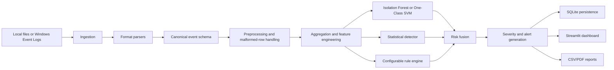

# Offline SOC Monitoring

## Project Report

## 1. Executive summary

Offline SOC Monitoring is a local, air-gapped log-analysis application for security operations, incident triage, and anomaly discovery. It accepts local log files or Windows Event Logs, converts heterogeneous records into a common schema, extracts security-focused features, scores unusual behavior with machine-learning and statistical detectors, applies configurable rules, calculates a unified risk score, assigns severity, stores results in SQLite, and presents the results in a Streamlit dashboard.

The system is designed for environments where logs must be analyzed on the machine that collected them and external APIs or cloud services are not available or not permitted. It also provides a command-line batch mode and CSV/PDF report export.

## 2. Project purpose and problem statement

Security logs are generated in different formats and often contain inconsistent fields, timestamps, levels, messages, usernames, source addresses, event identifiers, and vendor-specific terminology. Reviewing these records manually is slow and makes it difficult to identify:

- Bursts of failed authentication attempts.
- Unusual network or web activity.
- Error and failure patterns.
- Suspicious source or user behavior.
- Events that are unusual relative to the current data set.

This project provides one local workflow that normalizes multiple log sources, combines machine-learning and deterministic security signals, and exposes prioritized results to an analyst.

### Intended users

- Security operations and incident-response teams.
- System and network administrators.
- Students demonstrating a security analytics or machine-learning project.
- Operators of restricted or air-gapped environments.

### Typical use cases

1. Upload local log files and investigate anomalies.
2. Collect selected Windows Event Log channels and review high-risk events.
3. Monitor a local directory for newly appended log data.
4. Run a scheduled or manual batch scan from the command line.
5. Export findings as CSV for further analysis or PDF for an operational report.

## 3. High-level architecture



The central architectural principle is the canonical function [`run_pipeline`](./backend/pipeline.py). The dashboard, CLI, continuous monitor, database persistence, and reports use this same processing path so that results remain consistent.

## 4. How the system works

### 4.1 Ingestion

The ingestion layer in [`src/ingestion.py`](./src/ingestion.py) supports:

- `.csv`
- `.txt`
- `.log`
- `.json`
- `.jsonl`

CSV columns are normalized through aliases such as `msg` to `message`, `time` to `timestamp`, `severity` to `level`, and `filename` to `source_file`. Text files are converted into records with source file, source path, line number, raw line, message, timestamp, and detected level fields.

Large files are rejected before reading when they exceed the configured safety limit. Directory ingestion isolates individual files so one unreadable or oversized file does not abort the entire scan.

### 4.2 Parser dispatch

[`backend/parsers/__init__.py`](./backend/parsers/__init__.py) sends each raw line to the first parser whose `detect()` function recognizes it. The parser package includes:

- [`auth.py`](./backend/parsers/auth.py): SSH and authentication records.
- [`syslog.py`](./backend/parsers/syslog.py): RFC-style and ISO syslog records.
- [`web.py`](./backend/parsers/web.py): Apache and Nginx access records.
- [`windows.py`](./backend/parsers/windows.py): Windows event text and identifiers.
- [`cloudtrail.py`](./backend/parsers/cloudtrail.py): CloudTrail-style JSON.
- [`jsonl.py`](./backend/parsers/jsonl.py): JSON/JSONL records.
- [`firewall.py`](./backend/parsers/firewall.py): firewall events.
- [`network.py`](./backend/parsers/network.py): network and Suricata-oriented events.
- [`app.py`](./backend/parsers/app.py): application log records.

Unknown records are preserved as `event_type="unparsed"` instead of being silently discarded.

### 4.3 Schema normalization

[`backend/schema.py`](./backend/schema.py) defines the canonical event fields:

- Timestamp and event identifier.
- Source, source file, host, source IP, destination IP, and username.
- Event type, action, status, protocol, port, and HTTP fields.
- Severity, level, message, and raw log text.
- Parse status and parser name.

The normalization layer ensures required columns exist, preserves `raw_log`, and converts invalid timestamps to missing values with `errors="coerce"`.

Text normalization is centralized in `safe_text()` in [`backend/parsers/__init__.py`](./backend/parsers/__init__.py). It safely handles `None`, `NaN`, `pd.NA`, `pd.NaT`, numbers, booleans, and strings before parser operations such as `strip()`, `lower()`, and regular-expression matching.

### 4.4 Preprocessing

[`src/preprocessing.py`](./src/preprocessing.py) standardizes:

- Timestamp values.
- Text columns such as message, source, source file, source path, source, and component.
- Log levels.
- Empty messages and raw lines.
- Normalized lowercase messages.
- Word counts, event hour, day of week, business-hours status, and weekend status.

Duplicate records are removed using source path, line number, and raw line. Malformed records remain available for diagnostics and are counted in `PipelineBundle.malformed_count`.

### 4.5 Aggregation and feature engineering

The feature layer in [`src/feature_engineering.py`](./src/feature_engineering.py) creates numeric signals for anomaly detection. Examples include:

- Message length and word diversity.
- Digit, alphabetic, uppercase, punctuation, and special-symbol counts.
- Security, network, system, web, and AWS keyword counts.
- IP-address presence and frequency.
- Error-code and HTTP-status indicators.
- Login attempts, failed logins, successful logins, failed-login ratio, and login-burst score.
- Event rates, window counts, source-IP and username diversity.
- Request verbs, path tokens, keyword density, and port indicators.
- Timestamp, business-hours, weekend, source-kind, and source-density features.

The default aggregation window is 120 seconds and the default failed-login burst threshold is 5. These values are configurable.

### 4.6 Machine-learning detection

[`src/model.py`](./src/model.py) provides the shared `LogAnomalyModel` wrapper:

- **Isolation Forest** is the default detector.
- **One-Class SVM** is available as an alternative.
- Features are scaled with `StandardScaler`.
- Isolation Forest uses 300 estimators and a fixed random state.
- The contamination setting controls expected anomaly sensitivity.
- Raw model scores are normalized to the `0.0`–`1.0` anomaly-score range.

### 4.7 Statistical, rule, and context signals

The risk layer in [`backend/risk.py`](./backend/risk.py) combines four signal families:

| Signal | Default weight |
|---|---:|
| Machine learning | 0.5 |
| Statistical detection | 0.2 |
| Rules | 0.2 |
| Context | 0.1 |

Weights are normalized before use. The statistical detector contributes a complementary signal, while the rule engine evaluates configured expressions such as repeated failed logins. Context includes business-hours and weekend indicators.

### 4.8 Risk and severity

The fused result becomes a `risk_score` from 0 to 100. Current configurable boundaries are:

- Low: below 25.
- Medium: 25 to below 50.
- High: 50 to below 75.
- Critical: 75 and above.

Severity is the source of truth for `severity`, `severity_rank`, `severity_color`, `alert_required`, and `alert_message`. Medium, high, and critical records are treated as alerts by the current implementation.

### 4.9 Explainable alerts

The pipeline adds:

- Detector evidence.
- Rule match counts and rule weights.
- Statistical score.
- Context score.
- Risk score.
- Human-readable explanation.
- Alert message.

This allows an analyst to understand why a record was prioritized.

### 4.10 Persistence

[`backend/database.py`](./backend/database.py) stores local results in SQLite at `data/monitoring.db` by default. The database includes tables for:

- `events`
- `alerts`
- `analysis_runs`
- `alert_history`
- `rules`
- `model_metadata`
- `monitoring_sources`
- `audit_logs`
- `application_settings`

Events use signature keys for duplicate prevention. Repeated scans do not create duplicate event records for the same signature.

## 5. Dashboard operation

The Streamlit interface is implemented in [`app/dashboard.py`](./app/dashboard.py).

### Main controls

The sidebar provides:

- Input source selection.
- Detection engine selection.
- Sensitivity control.
- Continuous monitoring enable/disable control.
- Local paths or directories to watch.
- Start and stop monitoring actions.

### Upload mode

1. Select **Upload files**.
2. Choose one or more CSV, TXT, or LOG files.
3. Review the visible collected-data preview.
4. Review metrics and charts.
5. Open **Alerts to review** for prioritized records.
6. Open **Processed records** for the complete analyzed table.
7. Download CSV results or a PDF report.

### Windows Event Log mode

1. Select **Windows Event Logs**.
2. Select channels such as System, Application, or Security.
3. Use **Load selected logs** to collect available events.
4. Review collection diagnostics and the collected-data preview.
5. Investigate alerts and export results.

Collection can use the bundled administrative CSV export, `pywin32`, or `wevtutil`, depending on availability and permissions. The dashboard reports permission and collection failures instead of silently presenting an empty success result.

### Continuous local monitoring

[`backend/monitoring.py`](./backend/monitoring.py) uses watchdog to observe supported local files and directories. It:

- Watches created and modified files.
- Reads only new content after a checkpoint.
- Preserves line numbers and file offsets.
- Sends appended records through `run_pipeline`.
- Persists results locally.

## 6. Command-line operation

The launcher is [`main.py`](./main.py).

### Start the dashboard

```bash
python main.py --dashboard
```

Equivalent direct command:

```bash
streamlit run app/dashboard.py
```

### Run a batch scan

```bash
python main.py data/logs/linux_syslog_sample.log data/logs/aws_cloudtrail_sample.csv
```

Example with options:

```bash
python main.py data/logs --output-dir reports/run-1 --contamination 0.12 --algorithm isolation_forest
```

The batch command writes:

- `processed_log_analysis.csv`
- `offline_log_monitoring_report.pdf`

## 7. Configuration and technology stack

Default behavior is defined in [`backend/config.py`](./backend/config.py) and can be overridden through [`config/defaults.json`](./config/defaults.json).

Important settings include:

- Default contamination: `0.12`.
- Risk-fusion weights.
- Aggregation window: 120 seconds.
- Failed-login burst threshold: 5.
- Monitoring polling interval: 10 seconds.
- Duplicate prevention.
- Severity boundaries.
- Enabled rules and rule weights.

The project uses:

- Python.
- Pandas and NumPy.
- Scikit-learn.
- Streamlit.
- Plotly.
- ReportLab.
- Watchdog.
- SQLite.
- PyWin32 on Windows.
- Pytest and pytest-cov.

Recommended setup:

```bash
python -m venv .venv
.venv\Scripts\activate
pip install -r requirements.txt
python main.py --dashboard
```

## 8. Repository structure

| Area | Responsibility |
|---|---|
| [`app/`](./app) | Streamlit dashboard and user workflow |
| [`backend/`](./backend) | Pipeline orchestration, parsers, persistence, monitoring, risk, rules, alerts, and reporting |
| [`src/`](./src) | Ingestion, preprocessing, feature engineering, models, severity, and Windows collection |
| [`data/logs/`](./data/logs) | Bundled Linux, web, AWS, and Windows sample inputs |
| [`reports/`](./reports) | Generated CSV/PDF outputs |
| [`tests/`](./tests) | Unit and integration tests |
| [`main.py`](./main.py) | CLI and dashboard launcher |
| [`requirements.txt`](./requirements.txt) | Python dependency manifest |

## 9. Validation and observed results

The implementation has been validated using the existing tests, direct pipeline runs, and the live Streamlit health endpoint.

### Automated tests

The current suite contains **59 passing tests** covering:

- Aggregation.
- Database behavior.
- Persistence.
- Risk and severity.
- Explanations.
- Rule-engine operators.
- Pipeline integration.
- CSV export fields.
- Mixed-type and malformed log values.

### Bundled sample run

The bundled sample scan processed **67 records** across Linux, authentication, Apache, Nginx, AWS CloudTrail, and Windows sample logs. It generated CSV and PDF outputs under `reports/`.

### Live dashboard evidence

The local Streamlit health endpoint responded with HTTP 200:

```text
http://localhost:8501/_stcore/health
```

A verified Windows Event Log run displayed:

- 462 records analyzed.
- 18 records parsed successfully.
- 444 malformed or unparsed records reported.
- 56 anomalies.
- 34 high alerts.
- 4 critical alerts.

The application continued processing valid records instead of aborting on malformed or mixed-type rows.

## 10. Data quality and error handling

The application distinguishes between:

- Successfully parsed records.
- Malformed or unparsed records.
- Empty or invalid input.
- Collection diagnostics and permission failures.

Invalid timestamps are coerced to missing values. Unknown log formats are preserved as unparsed events. Missing or numeric values in textual fields are normalized safely without converting numeric feature columns to strings. The dashboard exposes processing diagnostics showing parsed, malformed/unparsed, and analyzed counts.

## 11. Security and privacy characteristics

- Processing is local by design.
- No external API is required for the core pipeline.
- Logs remain on the local machine unless the operator explicitly exports or shares a report.
- SQLite persistence is local.
- The system supports air-gapped operation subject to local dependency installation.

This is a monitoring and analytics tool, not a complete enterprise SIEM. It does not replace access control, endpoint protection, centralized retention, incident-response procedures, or human investigation.

## 12. Limitations and future improvements

### Current limitations

- Windows Event Log collection depends on local permissions and available Windows tooling.
- Parser coverage is heuristic and vendor-specific formats may require refinement.
- Unsupervised anomaly scores depend on the current data set and contamination setting.
- The generated PDF currently contains a compact summary and a limited table of top records rather than a full paginated export.
- The application is designed for local analysis and does not provide a multi-user server or centralized authentication layer.
- Continuous monitoring uses local watchdog events and checkpoint state; production deployment would need stronger service supervision and retention controls.

### Potential future work

- Add more vendor-specific parsers and parser-confidence indicators.
- Add analyst feedback loops and supervised model evaluation.
- Add dashboard filters by source, severity, user, IP, and time range.
- Add richer PDF reports with charts and full alert details.
- Add model-quality metrics using labeled validation data.
- Add secure centralized deployment for organizations requiring shared SOC operations.

## 13. Conclusion

Offline SOC Monitoring is a modular security analytics project that combines log parsing, schema normalization, feature engineering, unsupervised machine learning, statistical analysis, deterministic rules, risk fusion, severity classification, explainable alerts, SQLite persistence, and a Streamlit dashboard.

Its most important design decision is the canonical pipeline in [`backend/pipeline.py`](./backend/pipeline.py). Every supported interface uses the same processing sequence, keeping results consistent across interactive dashboard analysis, batch scans, continuous monitoring, database records, and exported reports. The current implementation is suitable for offline demonstrations, local investigations, academic evaluation, and as a foundation for a more complete SOC platform.
